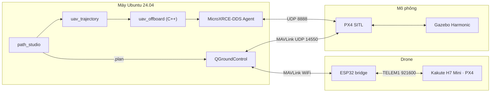

# Kiến trúc hệ thống

Bản trình bày đầy đủ (có sơ đồ): xem artifact kiến trúc đi kèm đồ án. File này là bản rút gọn để lưu cùng mã nguồn.

## 1. Yêu cầu đề bài

| Chỉ tiêu | Giá trị | Kiểm chứng |
| --- | --- | --- |
| Thời gian bay | 12–15 phút | `analysis/endurance.py` |
| Sai số tư thế | < 5° | `tests/test_attitude_step.py` |
| Overshoot / settling | < 15 % / < 2 s | `tests/test_attitude_step.py` |
| RMSE bám quỹ đạo | < 0.5 m ở 1–2 m/s | `tests/test_tracking.py` |
| Độ cao danh định | 6 m AGL (độ nhạy 4/8/10 m) | `tests/test_tracking.py` |
| Bao phủ | 50 × 50 m = 0.25 ha | `uav_trajectory` coverage |

## 2. Các khối

## 3. Hai nhánh thực thi quỹ đạo

| | Nhánh A – Offboard (ROS 2) | Nhánh B – Mission (MAVLink) |
| --- | --- | --- |
| Dùng khi | Mô phỏng SITL | Bay thật |
| Đường truyền | uXRCE-DDS, UDP | MAVLink qua ESP32 WiFi |
| Setpoint | p, v, a feedforward ở 50 Hz | chuỗi waypoint |
| Khi mất kết nối | PX4 thoát offboard → failsafe | drone tự hoàn thành nhiệm vụ / RTL |

Kakute không có máy tính đồng hành để chạy ROS 2 trên drone, nên bay thật dùng mission.

## 4. Cascade PID (PX4)

| Vòng | Bộ điều khiển | Tần số | Tham số chính |
| --- | --- | --- | --- |
| Vị trí | P | 50 Hz | `MPC_XY_P`, `MPC_Z_P` |
| Vận tốc | PID | 50 Hz | `MPC_XY_VEL_P/I/D_ACC`, `MPC_Z_VEL_P/I/D_ACC` |
| Attitude | P | 250 Hz | `MC_ROLL_P`, `MC_PITCH_P`, `MC_YAW_P` |
| Tốc độ góc | PID | 1 kHz | `MC_ROLLRATE_P/I/D`, `MC_PITCHRATE_*`, `MC_YAWRATE_*` |

## 5. Phiên bản

| Thành phần | Phiên bản |
| --- | --- |
| PX4-Autopilot | v1.17.0 |
| px4_msgs | `release/1.17` |
| ROS 2 | Jazzy |
| Gazebo | Harmonic |
| Micro XRCE-DDS Agent | v2.4.3 |

## 6. Lộ trình

| GĐ | Nội dung | Xong khi |
| --- | --- | --- |
| 0 | Repo, môi trường | `gz_x500` bay trong QGC; `ros2 topic echo` có dữ liệu |
| 1 | Model `rice_uav` trong Gazebo | bay treo ổn định 6 m |
| 2 | Mô hình 6-DOF, chỉnh gain | test bước góc đạt chỉ tiêu |
| 3 | `uav_trajectory` + `uav_offboard` | bay lưới 0.25 ha, RMSE < 0.5 m |
| 4 | `path_studio` | bay theo nét vẽ tùy ý |
| 5 | ESP32 bridge | QGC qua WiFi, mất gói < 1 % ở 30 m |
| 6 | Phần cứng | preflight check xanh, động cơ đúng thứ tự |
| 7 | Bay thử | log + video bay theo quỹ đạo vẽ |
| 8 | Hoàn thiện | người khác clone về chạy lại được |
